# Worktime Database Schema

Postgres · Liquibase · Drizzle ORM

31 documented core application tables are covered across thirteen subsystems; plugin-owned tables are inventoried separately below.\
Many tenant-owned tables carry `organization_id` directly; global tables and tables scoped through a parent relationship do not.\
`project_times.organization_id` is required because every entry belongs to an organization whether or not it is tagged to a project.\
Each section below is a self-contained entity-relationship diagram for one subsystem; tables that also appear elsewhere (mainly `organizations` and `users`) are shown with just their primary key for context — their full column list lives in the section where they're introduced.

**Notation:** `PK` primary key · `FK` foreign key · `UK` unique constraint.
Routine creation/update timestamps are omitted for clarity; timestamps that are
part of a table's domain data or history are shown.

## Identity & Organizations (5 tables)

Users, how they authenticate, and the tenant tree they belong to. Security
settings and SSO federation live directly on the organization row, not in side
tables. `organizations.settings` (jsonb) also holds `branding`: the organization's
header/page/sidebar colors and logo (see `packages/shared/src/branding.ts`), and
`twoFactor` (`off` / `privileged` / `all`): who must use two-step login.
`user_two_factor` (099) holds an account's two-step login: the authenticator secret
(encrypted with a key derived from `API_JWT_SECRET`), whether a first code confirmed it,
the one-time recovery codes as hashes and the last time step used (each code works once).
`organizations.enforce_mfa` is not read.

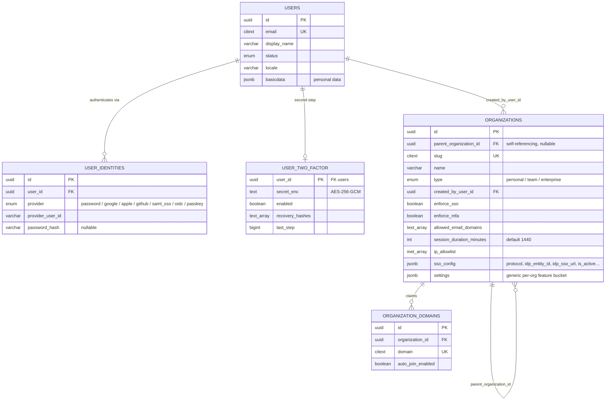

> Folded in from two 1:1 tables that used to sit beside `organizations` —
> `organization_settings` (flattened into real columns) and
> `sso_configurations` (kept as the `sso_config` JSON blob, same field names).

## Basic Data History (1 table)

Each user has a JSON document for personal data on `users.basicdata`. Change
requests and approved/rejected revisions are recorded in a single history row
per user; the application owns the shape and status values in its `history`
array.

```mermaid
erDiagram
    USERS ||--o| BASICDATA_VERSIONS : "tracks changes for"
    USERS ||--o{ BASICDATA_VERSIONS : "lastmodified_by_user_id"

    BASICDATA_VERSIONS {
        uuid id PK
        uuid user_id FK UK
        integer version_nr "default 0, check: >= 0"
        timestamptz created
        timestamptz lastmodified
        uuid lastmodified_by_user_id FK "nullable"
        jsonb history "approved / changerequested / rejected revisions"
    }
    USERS { uuid id PK }
```

## Access Control / RBAC (6 tables)

Roles can be system-wide (`organization_id` null) or scoped to one org. A
membership now holds **any number** of roles at once, through
`membership_roles` — permissions are additive across them.

```mermaid
erDiagram
    ORGANIZATIONS ||--o{ ROLES : "defines"
    ROLES ||--o{ ROLE_PERMISSIONS : "grants"
    PERMISSIONS ||--o{ ROLE_PERMISSIONS : "granted via"
    ORGANIZATIONS ||--o{ ORGANIZATION_MEMBERSHIPS : "admits"
    USERS ||--o{ ORGANIZATION_MEMBERSHIPS : "joins"
    ORGANIZATIONS ||--o{ DEPARTMENTS : "has"
    USERS ||--o{ DEPARTMENTS : "leader_user_id"
    USERS ||--o{ EMPLOYEE_ASSIGNMENTS : "user_id / manager_user_id"
    DEPARTMENTS ||--o{ EMPLOYEE_ASSIGNMENTS : "department_id"
    ORGANIZATION_MEMBERSHIPS ||--o{ MEMBERSHIP_ROLES : "holds"
    ROLES ||--o{ MEMBERSHIP_ROLES : "granted as"
    USERS ||--o{ MEMBERSHIP_ROLES : "granted_by_user_id"
    ORGANIZATIONS ||--o{ ORGANIZATION_INVITATIONS : "sends"
    ROLES ||--o{ ORGANIZATION_INVITATIONS : "pre-assigns"
    USERS ||--o{ ORGANIZATION_INVITATIONS : "invited_by_user_id"

    ROLES {
        uuid id PK
        uuid organization_id FK "null = system role"
        varchar name
        boolean is_system_role
        jsonb translations "locale -> display_name"
        uuid_array admin_user_ids "may grant/revoke THIS role for others"
    }
    PERMISSIONS {
        varchar id PK "e.g. teams:manage"
        varchar description
    }
    ROLE_PERMISSIONS {
        uuid role_id PK "FK -> roles"
        varchar permission_id PK "FK -> permissions"
    }
    ORGANIZATION_MEMBERSHIPS {
        uuid id PK
        uuid organization_id FK
        uuid user_id FK
        enum status "active / invited / suspended"
        timestamptz joined_at "nullable — when the account joined"
        date start_date "nullable — employment start (balances count from it)"
        timestamptz exit_at "nullable — membership end; must be after joined_at when both are set"
        jsonb settings "free-form per-membership bucket: validity dates, planned holidays, etc."
    }
    DEPARTMENTS {
        uuid id PK
        uuid organization_id FK
        text name "unique per org"
        uuid leader_user_id FK "nullable — default leader, only suggested as manager"
        boolean is_active
        int sort_order
    }
    EMPLOYEE_ASSIGNMENTS {
        uuid id PK
        uuid organization_id FK
        uuid user_id FK
        date valid_from "unique per (org, user); in force until the next row"
        uuid department_id FK "nullable"
        text job_function "nullable"
        uuid manager_user_id FK "nullable — who approvals route to; null = top of chain"
    }
    MEMBERSHIP_ROLES {
        uuid membership_id PK "FK -> organization_memberships"
        uuid role_id PK "FK -> roles"
        timestamptz granted_at
        uuid granted_by_user_id FK "nullable"
    }
    ORGANIZATION_INVITATIONS {
        uuid id PK
        uuid organization_id FK
        citext email
        uuid role_id FK "single role — extra roles are granted after acceptance"
        varchar token UK
        enum status "pending / accepted / revoked / expired"
    }
    USERS { uuid id PK }
    ORGANIZATIONS { uuid id PK }
```

> One membership row per `(organization_id, user_id)` — `uq_org_user_membership`
> — but any number of rows in `membership_roles` for it. Granting or revoking a
> role requires being an org owner/admin, or being listed in that role's own
> `admin_user_ids`. A member's manager is the `manager_user_id` of their
> `employee_assignments` row in force (latest `valid_from` on or before the day):
> who their timesheet, absence and expense submissions route to (see Timesheets
> below); a change is a new dated row, so the history stays. An org admin can
> always review/approve regardless of this chain.

## Teams (2 tables)

A team rosters existing org memberships, not users directly. Each team has one
designated lead (an org admin's call, not the members' own) who — along with
org admins — is the only one allowed to onboard/offboard members on that team;
a team-specific role can additionally be layered on each seat.

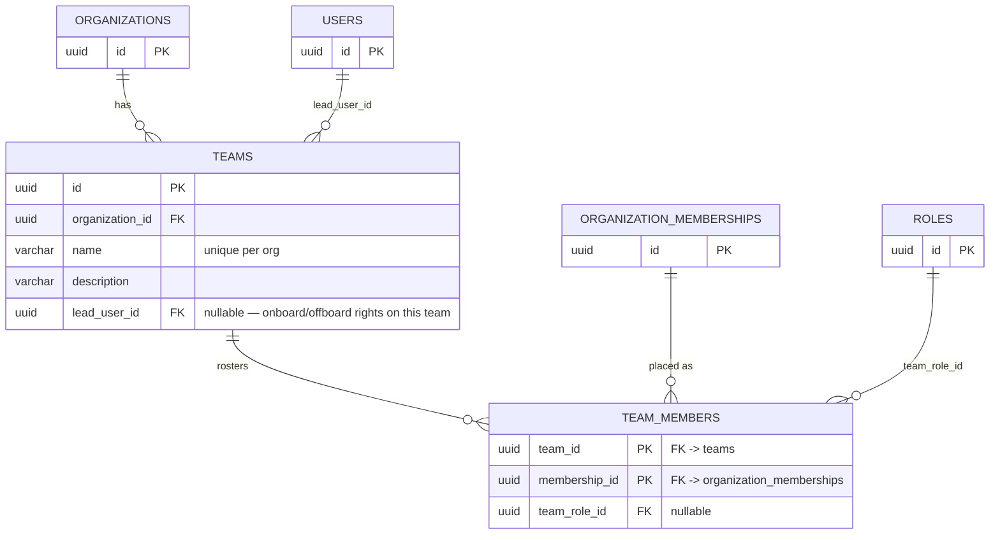

## Projects & Time Tracking (4 tables)

Work entries tag an optional project/subproject; both fall back to null on
delete rather than orphan the entry. `project_teams` (070) limits a project to
teams: only their members and leads, and the project's owner, book time on it;
a project without rows is open to everyone. A team still assigned to a project
can't be deleted (RESTRICT).

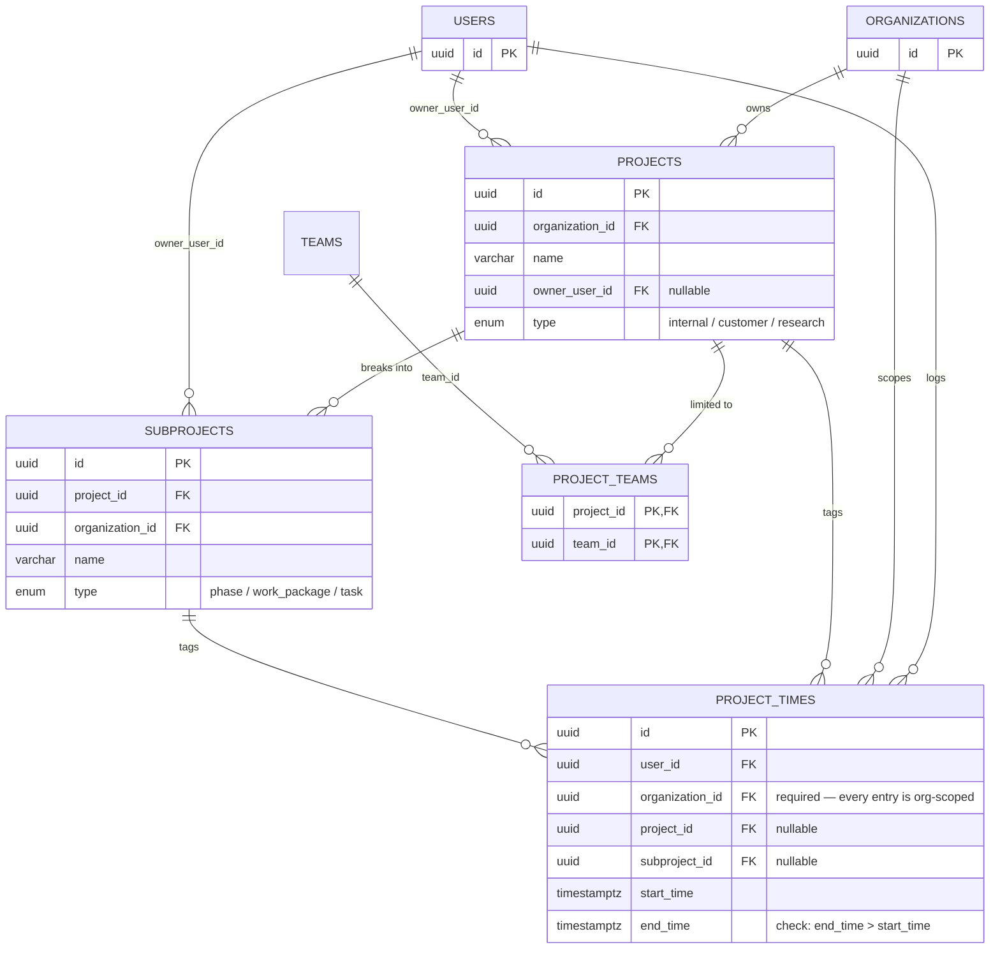

## Timesheets (1 table)

Month-end lock/approve state for a person's booked hours.

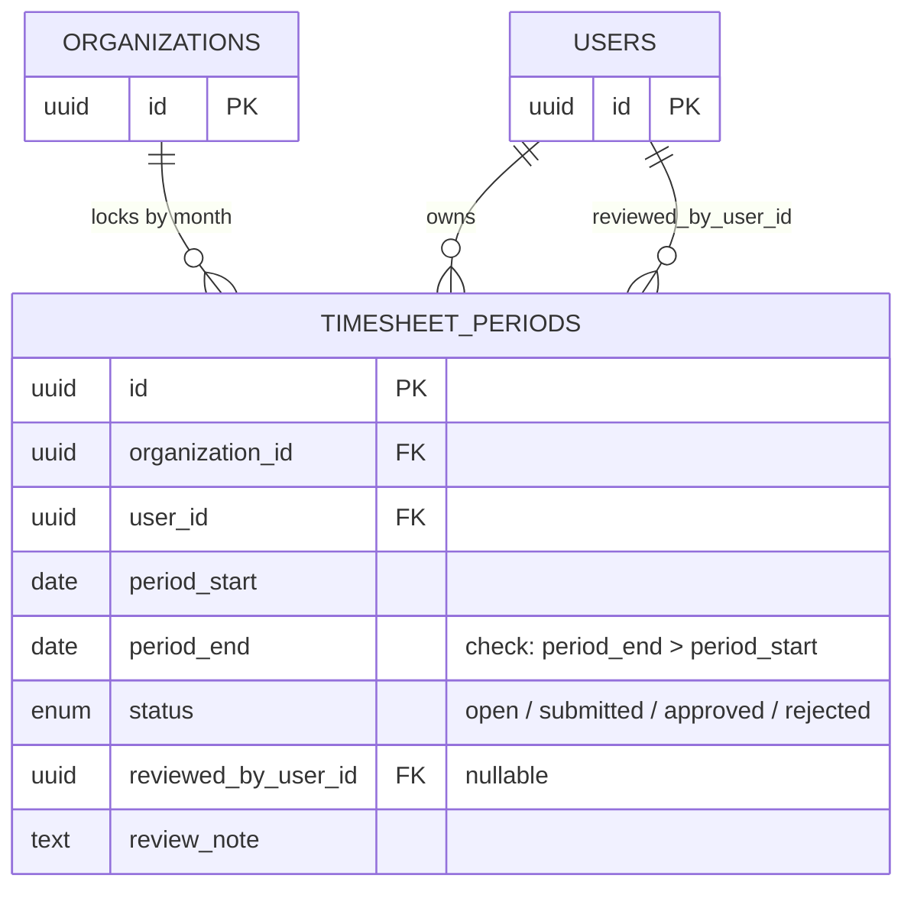

> One period per `(organization_id, user_id, period_start)` —
> `uq_timesheet_period`. Work-time and absence writes are rejected once the
> covering period is `submitted` or `approved`.
>
> `project_time_periods` is the project timesheet: one row per
> `(organization_id, user_id, project_id, period_start)`
> (`uq_project_time_periods`), with the same statuses, approved by the
> project's owner. A `submitted` or `approved` row locks that person's
> project time on that project in that month; the working-time timesheet
> does not lock project time.

## Attendance & Balances (9 tables)

`work_times` is the attendance clock (check-in/check-out stamps) — distinct
from `project_times`, which tags hours against a project/activity rather
than recording whether someone was at work at all. A person's daily target
comes from `work_schedules` (minutes per weekday, with history), public
holidays (the canton in `organizations.settings.holidayRegion` plus
`org_holidays`) and approved `absences` (see `packages/shared/src/worktime.ts`).
A schedule with `time_recording = 'none'` (095, with `exemption_reason`
`senior_executive` or `waiver`) has no target, timesheet or overtime; `daily`
is reserved. `organization_memberships.probation_until` is a person's end of
probation where it differs from `settings.vacation.probationMonths`.

Balances are derived (`apps/api/src/balances.service.ts`). Approving a
working-time timesheet closes its month: `work_time_months` freezes target,
attendance, holiday and absence minutes (per absence type), vacation days
taken and Überzeit (`legal_overtime_minutes`; NULL for months closed before
046, computed from attendance); reopening the timesheet deletes the row. Months not closed are computed
live. The overtime balance is the sum of the months' differences plus
`balance_adjustments` (opening balance, correction, payout; minutes for
overtime, full-time days for vacation). Überzeit (legal overtime, Swiss ArG) is
the share of attendance beyond `settings.legalMaxWeeklyMinutes` (45 h default)
per calendar week; it is part of the overtime balance, tracked as its own
account against `settings.legalOvertimeYearLimitMinutes` (170 h / 140 h), and
`legal_overtime` adjustments (e.g. a payout) move both. Vacation is counted in full-time days:
the yearly entitlement follows the rules in `settings.vacation` (095: dated
base days, management days for `employee_assignments.is_management`, age steps;
without rules `settings.vacationDaysPerYear`, default 25, less a twelfth per
full 30 days of absence types marked `unpaid`, 096) prorated
by the schedule's workload and the counting start, unless `vacation_entitlements`
sets that year's days for the person; days taken come from approved
`vacation` absences; the rest carries over to the next year. Balances count
from `settings.balancesStartDate`, else from each person's first recorded
activity. `work_time_balance_entries` / `work_time_balances` are the earlier
ledger, migrated by 042 and no longer written.

```mermaid
erDiagram
    ORGANIZATIONS ||--o{ WORK_TIMES : "scopes"
    USERS ||--o{ WORK_TIMES : "logs"
    ORGANIZATIONS ||--o{ ABSENCES : "scopes"
    USERS ||--o{ ABSENCES : "requests"
    USERS ||--o{ ABSENCES : "reviewed_by_user_id"
    ORGANIZATIONS ||--o{ WORK_TIME_BALANCES : "scopes"
    USERS ||--o| WORK_TIME_BALANCES : "has"
    ORGANIZATIONS ||--o{ WORK_TIME_BALANCE_ENTRIES : "scopes"
    USERS ||--o{ WORK_TIME_BALANCE_ENTRIES : "affects"
    USERS ||--o{ WORK_TIME_BALANCE_ENTRIES : "created_by_user_id"
    USERS ||--o{ WORK_SCHEDULES : "works to"
    ORGANIZATIONS ||--o{ ORG_HOLIDAYS : "observes"
    USERS ||--o{ WORK_TIME_MONTHS : "closed month"
    TIMESHEET_PERIODS ||--o| WORK_TIME_MONTHS : "approval closes"
    USERS ||--o{ BALANCE_ADJUSTMENTS : "adjusted"
    USERS ||--o{ VACATION_ENTITLEMENTS : "entitled"

    WORK_TIMES {
        uuid id PK
        uuid user_id FK
        uuid organization_id FK
        timestamptz check_in
        timestamptz check_out "nullable — null means still checked in"
        text comment "nullable"
    }
    ABSENCES {
        uuid id PK
        uuid organization_id FK
        uuid user_id FK
        date date_start
        date date_end "check: date_end >= date_start"
        varchar absence_type "default 'vacation' — static_data-backed (entity=absences, enum_name=absence_type)"
        boolean half_day "default false — check: only true when date_start = date_end"
        uuid document_id FK "nullable -> documents; evidence for this request"
        enum status "pending / approved / rejected"
        uuid reviewed_by_user_id FK "nullable"
        text review_note "nullable"
        text note "nullable — requester's own note"
    }
    WORK_TIME_BALANCES {
        uuid organization_id PK "FK -> organizations"
        uuid user_id PK "FK -> users"
        numeric overtime_minutes "signed running total"
        numeric vacation_minutes "signed running total"
    }
    WORK_TIME_BALANCE_ENTRIES {
        uuid id PK
        uuid organization_id FK
        uuid user_id FK
        enum balance_type "overtime / vacation"
        text source_table "polymorphic — no FK, like versions.source_table; null = manual adjustment"
        uuid source_table_uuid "polymorphic — no FK"
        numeric target_minutes "nullable — only meaningful for overtime entries"
        numeric actual_minutes "nullable — only meaningful for overtime entries"
        numeric delta_minutes "signed change this entry applies"
        text note "nullable"
        uuid created_by_user_id FK "nullable"
    }
    WORK_SCHEDULES {
        uuid id PK
        uuid organization_id FK
        uuid user_id FK
        date valid_from
        numeric workload_percent
        int_array day_minutes "Mon..Sun"
    }
    ORG_HOLIDAYS {
        uuid id PK
        uuid organization_id FK
        date date
        text name
        numeric fraction
        boolean observed "false = canton holiday worked"
    }
    WORK_TIME_MONTHS {
        uuid id PK
        uuid organization_id FK
        uuid user_id FK
        date month
        uuid timesheet_period_id FK
        int target_minutes
        int actual_minutes
        int delta_minutes
        jsonb absence_minutes "per absence type"
        numeric vacation_days
    }
    BALANCE_ADJUSTMENTS {
        uuid id PK
        uuid organization_id FK
        uuid user_id FK
        text balance "overtime | vacation"
        text kind "opening | correction | payout"
        date effective_date
        numeric amount "minutes or days"
    }
    VACATION_ENTITLEMENTS {
        uuid id PK
        uuid organization_id FK
        uuid user_id FK
        int year
        numeric days
    }
    TIMESHEET_PERIODS { uuid id PK }
    ORGANIZATIONS { uuid id PK }
    USERS { uuid id PK }
```

> One open session per person at a time, globally — enforced by
> `uq_work_times_one_open_session`, a unique index on `user_id` where
> `check_out IS NULL`. `work_time_months` has one row per
> `(organization_id, user_id, month)` (`uq_work_time_months`); absences are
> refused for days in a submitted or approved month, whose numbers are frozen.

## Documents (3 tables)

Generic uploaded-file metadata (a doctor's note for an absence, a pay slip
for an expense) — one table reused by any record that needs at most one
evidence attachment, rather than a bespoke table per attachment kind. The
owning record (`absences`, `expenses`) holds the relationship, via its own
nullable `document_id` FK into this table; access control is always
checked through that owning row (its own owner/manager/admin rules), never
through `documents` directly. The file itself lives on local disk under
the API server (path controlled by `DOCUMENTS_DIR`), keyed by
`storage_path`.

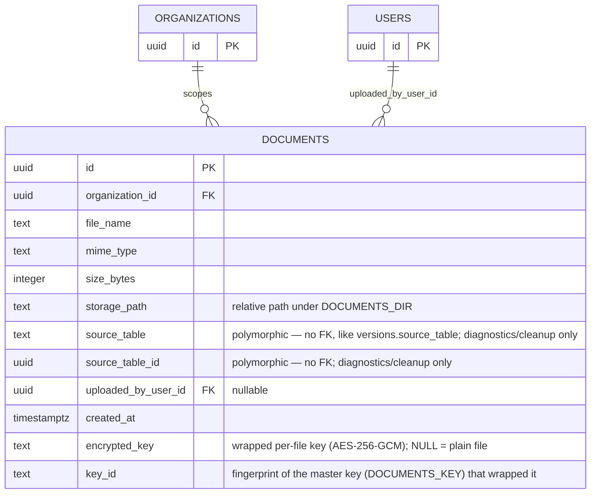

> `source_table`/`source_table_id` are a reverse pointer to whatever row
> this was uploaded for (e.g. `('absences', <absence id>)`) — useful for
> "every document ever attached to record X" queries, but not what access
> control or the UI's "does this record have a document" check goes
> through; that's always the owning row's own `document_id` FK (a record
> can only ever have the *one* document that FK currently points to).
> Uploading a replacement deletes the previous `documents` row and file
> rather than keeping history.

`timesheet_documents` (057, 059) links an issued PDF to a person and a month:
`kind = 'timesheet'` is the working-time timesheet of `timesheet_period_id`;
`kind = 'project_timesheet'` is the monthly project report (all of the
person's projects that month, each with its approval status), identified by
person and `period_start`. Approving or reopening a month issues a new
version and sets `superseded_at` on the previous one, so at most one row per
timesheet / person-month is current (partial unique indexes). The Documents
page lists these with the person's absence and expense evidence, the
attachments of their flows and the personnel-file documents shared with
them.

Files are encrypted at rest (060): each with its own key, wrapped with the
master key `DOCUMENTS_KEY` from the environment (`encrypted_key`, `key_id`).

`personnel_documents` (061) is HR's personnel file: one row per document HR
keeps for a person (`category` evaluation, bonus, contract, certificate,
salary, other; optional `document_date`), shared with the person when
`visible_to_employee`.

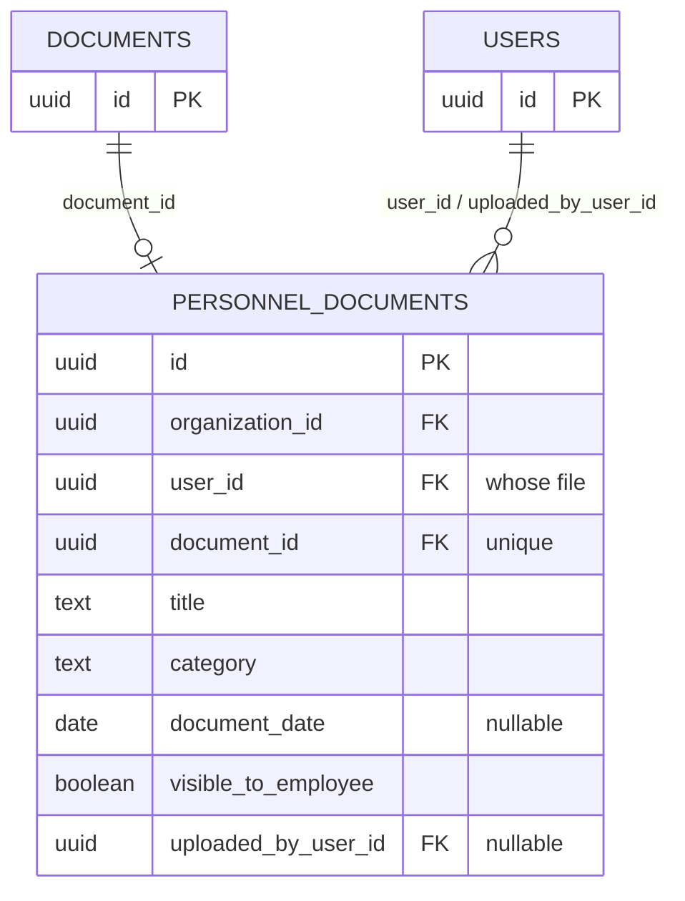

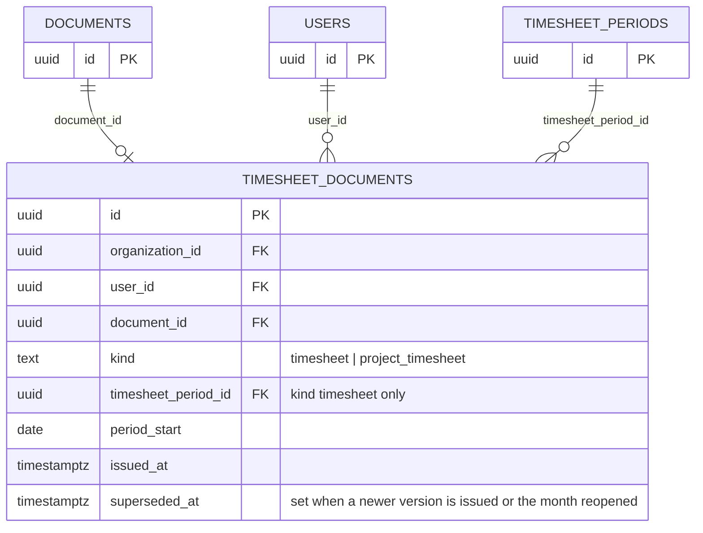

## Expenses (5 tables; 3 diagrammed here)

Employees log ad hoc expense line items and bundle a self-chosen subset into
an expense report for approval — unlike `timesheet_periods` (an implicit
date-range envelope), a report here is explicit, so `expense_report_items`
links specific expenses to specific reports.

```mermaid
erDiagram
    ORGANIZATIONS ||--o{ EXPENSES : "scopes"
    USERS ||--o{ EXPENSES : "logs"
    PROJECTS ||--o{ EXPENSES : "tags"
    SUBPROJECTS ||--o{ EXPENSES : "tags"
    ORGANIZATIONS ||--o{ EXPENSE_REPORTS : "scopes"
    USERS ||--o{ EXPENSE_REPORTS : "owns"
    USERS ||--o{ EXPENSE_REPORTS : "reviewed_by_user_id"
    EXPENSE_REPORTS ||--o{ EXPENSE_REPORT_ITEMS : "bundles"
    EXPENSES ||--o| EXPENSE_REPORT_ITEMS : "included as"
    ORGANIZATIONS ||--o{ EXPENSE_REPORT_ITEMS : "scopes"

    EXPENSES {
        uuid id PK
        uuid user_id FK
        uuid organization_id FK
        uuid project_id FK "nullable"
        uuid subproject_id FK "nullable"
        date expense_date
        varchar category "static_data-backed picklist"
        varchar sub_category "nullable, static_data-backed picklist"
        numeric original_value "nullable, must be > 0"
        char original_currency "nullable, ISO 4217"
        char currency "ISO 4217"
        numeric quantity "nullable, must be >= 0"
        text comment "nullable"
        numeric value "default 0 — org-currency amount, hand-entered"
        uuid document_id FK "nullable -> documents; e.g. a pay slip"
    }
    EXPENSE_REPORTS {
        uuid id PK
        uuid organization_id FK
        uuid user_id FK
        text status "in_preparation / submitted / approved / rejected / submitted_processing / processing_finished / request_payment / finished — CHECK constraint, not a DB enum"
        timestamptz date_submitted "nullable"
        uuid reviewed_by_user_id FK "nullable"
        text review_note "nullable"
        jsonb data
    }
    EXPENSE_REPORT_ITEMS {
        uuid id PK
        uuid expense_report_id FK
        uuid expense_id FK UK "one report per expense"
        uuid organization_id FK
    }
    ORGANIZATIONS { uuid id PK }
    USERS { uuid id PK }
    PROJECTS { uuid id PK }
    SUBPROJECTS { uuid id PK }
```

> `original_value`/`original_currency` capture exactly what the receipt says
> and are both optional; `value` is the hand-entered amount in the org's
> reporting currency (`currency`), defaulting to 0 until filled in.
> `category`/`sub_category` are free-text picklists backed by `static_data`
> (entity `expenses`), not DB enums or FKs; `currency` is a three-letter ISO code.
> The expenses plugin owns these tables in `public` and declares them in `apensum.tables`; the two additional tables are listed in Plugin-owned data.

## Workflows & Notifications (3 tables)

Generic, definition-driven approval/request workflows (e.g. "reopen my
approved month") that can be assigned to one or more users or to a whole
team, plus the per-recipient notification rows they — and other events —
generate.

```mermaid
erDiagram
    ORGANIZATIONS ||--o{ WORKFLOW_DEFINITIONS : "defines"
    WORKFLOW_DEFINITIONS ||--o{ WORKFLOWS : "instantiates"
    TEAMS ||--o{ WORKFLOWS : "assigned_to_team_id"
    ORGANIZATIONS ||--o{ NOTIFICATIONS : "scopes"
    USERS ||--o{ NOTIFICATIONS : "recipient_user_id"
    WORKFLOWS ||--o{ NOTIFICATIONS : "raised by"

    WORKFLOW_DEFINITIONS {
        uuid workflow_def_id PK
        uuid organization_id FK
        text name
        text description "nullable"
        jsonb steps "ordered step definitions — shape owned by the app, not enforced here"
    }
    WORKFLOWS {
        uuid workflow_id PK
        uuid workflow_def_id FK
        text source_table "polymorphic — no FK, like versions.source_table"
        uuid source_table_uuid "polymorphic — no FK"
        jsonb workflow_data
        timestamptz workflow_started "nullable"
        timestamptz workflow_finished "nullable"
        timestamptz workflow_to_be_finished_until "nullable"
        text step "nullable — current step name"
        text step_status "nullable — free text, no CHECK"
        timestamptz workflow_step_started "nullable"
        timestamptz workflow_step_finished "nullable"
        timestamptz workflow_step_to_be_finished_until "nullable"
        uuid_array assigned_to_user_id "nullable, no FK (array)"
        uuid assigned_to_team_id FK "nullable"
        jsonb notification
    }
    NOTIFICATIONS {
        uuid id PK
        uuid organization_id FK
        uuid recipient_user_id FK
        text type
        text title
        text body "nullable"
        text source_table "polymorphic — no FK"
        uuid source_table_uuid "polymorphic — no FK"
        uuid workflow_id FK "nullable"
        jsonb data
        timestamptz read_at "nullable"
    }
    ORGANIZATIONS { uuid id PK }
    USERS { uuid id PK }
    TEAMS { uuid id PK }
```

> `chk_workflows_assignee_required`: a workflow must have `assigned_to_user_id`
> and/or `assigned_to_team_id` set. Notifications get one row per
> `(recipient, event)` rather than a single JSON blob on `workflows` — a
> team-assigned step must notify every member independently, each with their
> own read state. `NotificationsGateway` (WebSocket) only pushes a live copy
> of a row that already exists here, so a missed push is never a lost
> notification, only a delayed one.

## Flows (2 tables)

The "flows" module (052, renamed from requests in 110): a Free Flow a person
sends to their line manager or to a department, or a flow of the organization's
own type with set steps (`target_kind = 'workflow'`), with a message thread. Who handles it is not stored: for
`target_kind = 'manager'` it is the requester's manager in force
(`employee_assignments`), for `'department'` everyone whose assignment in force
is in `target_department_id` plus its leader. Changes notify the other side
through `notifications` (`source_table = 'flows'`). Since 069 a flow has
a type (`flow_type`, a key of the `flows`/`flow_type` static_data row),
an `urgent` flag (urgent open flows are listed first) and an optional
`link_url` (http(s) only).
A message's attachments are the documents that name it (`documents.source_table = 'flow_messages'`, `source_table_id` = the message; 115 dropped the link table `flow_message_documents`).

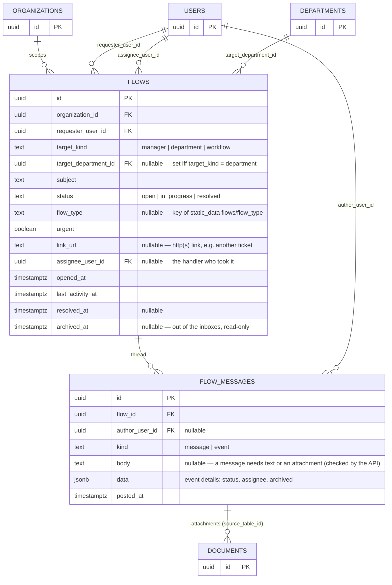

## News (3 tables)

The "news" module (080): posts an organization's admin or HR (`nav.news:edit`)
publishes to everyone, or to the departments in `department_ids` (115; empty = everyone; whoever's
assignment in force is in one of them, and its leaders; worked out per call).
`texts` holds a title and a Markdown text per language. `published_at` NULL is a
draft. Publishing notifies the audience (`notifications.source_table = 'news_posts'`)
and optionally mails them a link. `news_post_reads` records when each person
opened a post and, for a post with `require_ack`, confirmed reading it. Pictures
are the documents that name the post (`documents.source_table = 'news_posts'`, 115) and are shown as ``.
A post with `organization_id` NULL (082) is product news: written by a
operator for the admins of every organization, never with departments.
A product post with `is_public` (083) is also on the website (`public/news`)
and can be sent to the newsletter's confirmed subscribers; `newsletter_deliveries`
records who got it, so no one gets it twice.

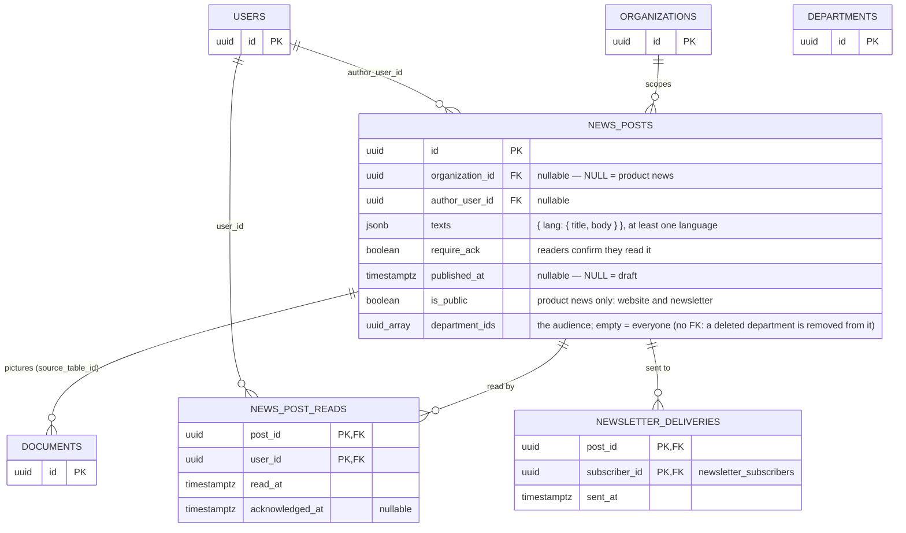

## Versioning (1 table)

Generic per-record version history: one row per tracked
`(source_table, source_table_uuid)` entity, holding the current version
number plus a full history of past actions.

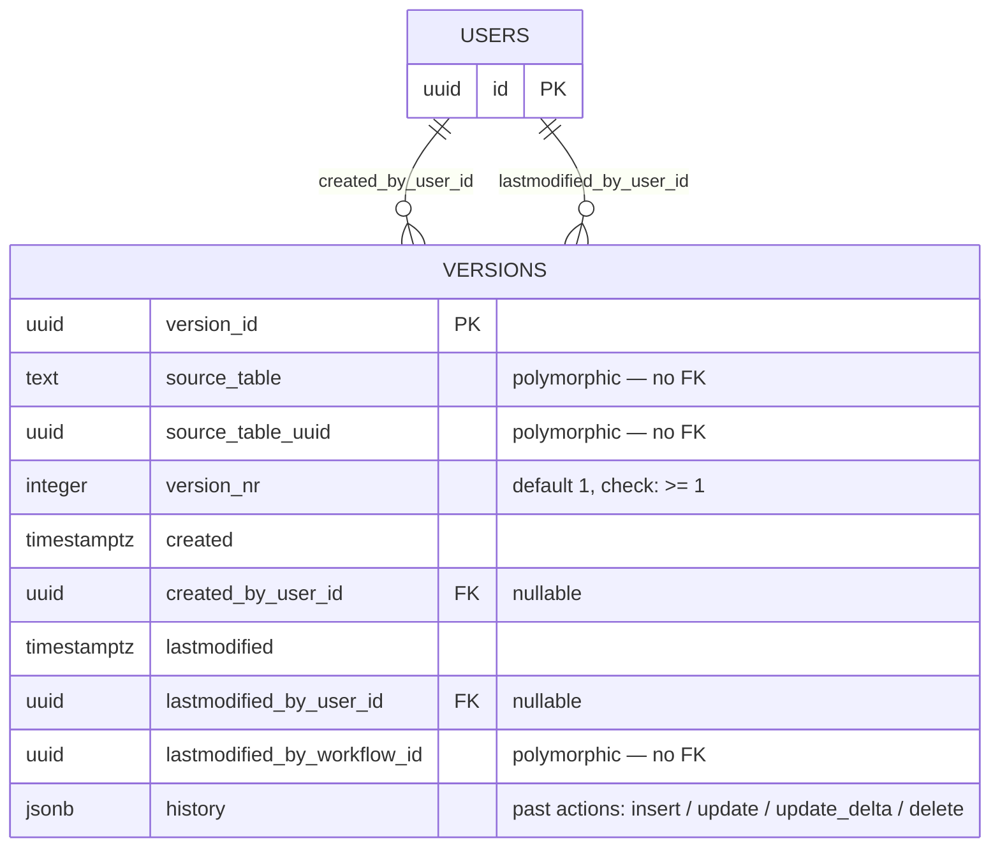

> `uq_versions_source_table_record`: one row per `(source_table,
> source_table_uuid)`. `source_table_uuid` and `lastmodified_by_workflow_id`
> are deliberately plain UUID columns with no FK — this table is polymorphic
> across every other table in the schema, so referential integrity for
> "which record" can't be enforced at the DB level here.

## Audit (1 table + 1 view)

Every administrative action (invites, timesheet review, SSO/domain config,
role grants) writes one row here.

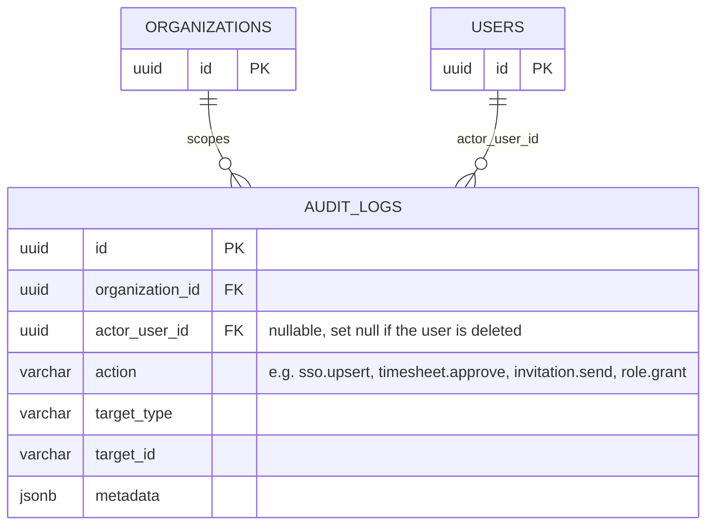

> `audit` is a read-only view over `audit_logs` exposing the same rows under
> legacy column names (`uuid`, `entity`, `actionby`) — not a separate table.

## Static Data (1 table)

Admin-managed dropdown/enum values (e.g. a project type list), scoped per
organization so different orgs can define their own — not a platform-wide
catalog.

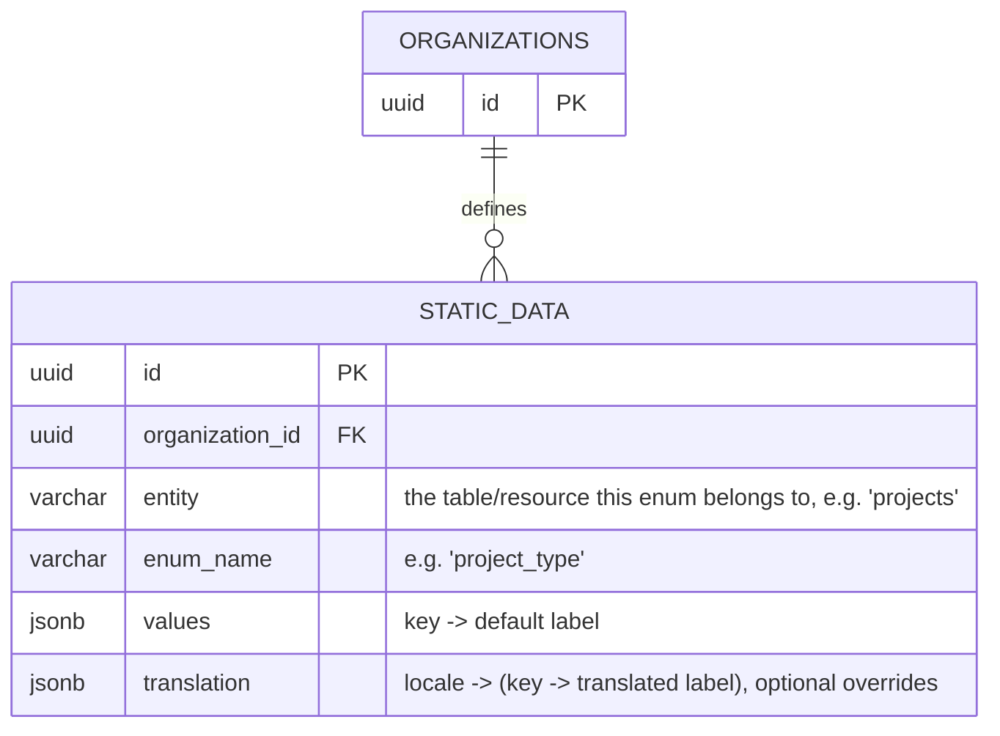

> One row per `(organization_id, entity, enum_name)` — `uq_static_data_org_entity_enum`.
> Managing it (create/edit/delete) requires being that organization's admin;
> any member can read it. Nothing references `static_data.id` by foreign key —
> consumers (e.g. `absences.absence_type`, entity `"absences"`/enum_name
> `"absence_type"`) match against its `values` keys at the application layer
> instead, falling back to a built-in default set if an org has no override row.

## Enumerated Types (10 enums)

| Enum | Values |
|---|---|
| `user_status` | `active`, `suspended`, `deactivated` |
| `auth_provider_type` | `password`, `google`, `apple`, `github`, `saml_sso`, `oidc`, `passkey` |
| `organization_type` | `personal`, `team`, `enterprise` |
| `membership_status` | `active`, `invited`, `suspended` |
| `invitation_status` | `pending`, `accepted`, `revoked`, `expired` |
| `project_type` | `internal`, `customer`, `research` |
| `subproject_type` | `phase`, `work_package`, `task` |
| `timesheet_status` | `open`, `submitted`, `approved`, `rejected` |
| `absence_status` | `pending`, `approved`, `rejected` |
| `balance_entry_type` | `overtime`, `vacation` |

`expense_reports.status` and `workflows.step`/`step_status` are plain `text`
columns, not DB enums — the former is CHECK-constrained (see Expenses above),
the latter is free-form.

## Saved reports

`saved_reports` (064) keeps a report of the Reports page under a name: `report_id`
(`packages/shared/src/reports.ts`), `settings` (period preset or custom months,
grouping, filters) and `shared_roles`, role **names** whose members see it too
(names, so an organization's own copy of a role still matches). Only the owner
changes it; everyone runs it with their own rights.

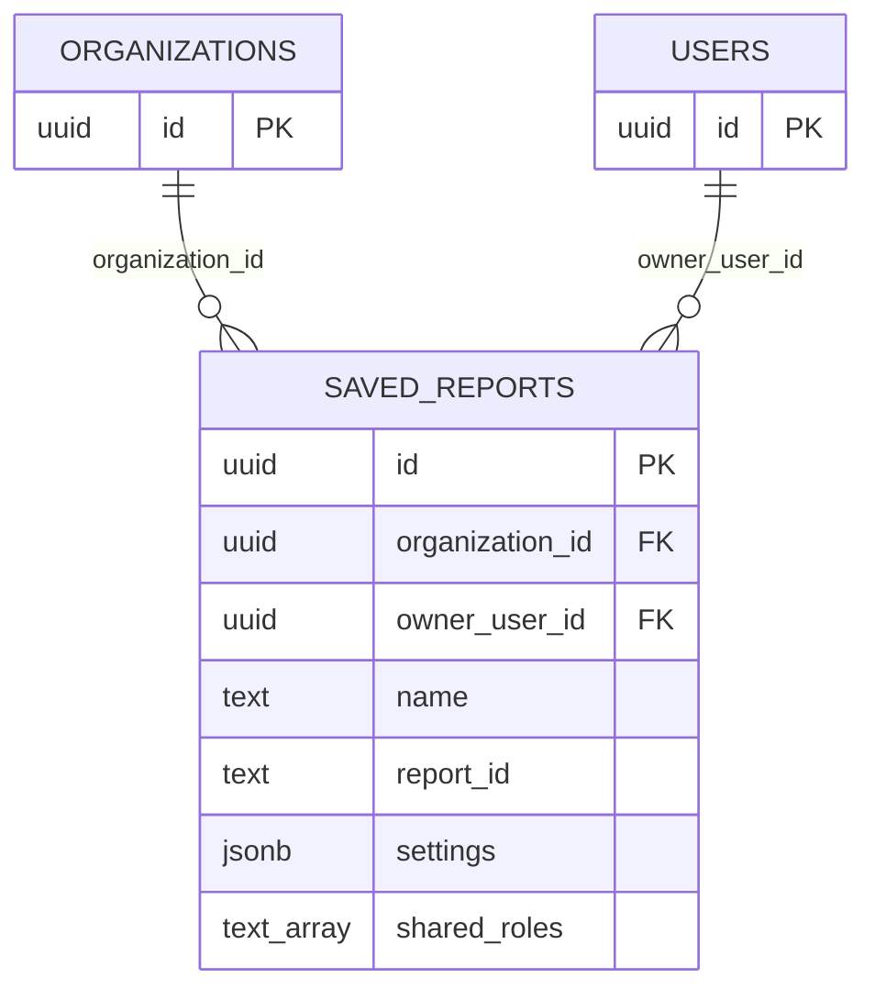

`report_schedules` (065) sends a saved report by itself: weekly (`weekday`
1-7) or monthly (`month_day` 1-28) at `hour` in `time_zone`, as `pdf` or
`xlsx`, to `recipient_user_ids`; `next_run_at` is when it is due (the job
runner claims a row by moving it on). Each run writes one `report_runs` row
per recipient, made with that recipient's rights: the file in `documents`
(listed on their Documents page), or `error` when they may not see the report.

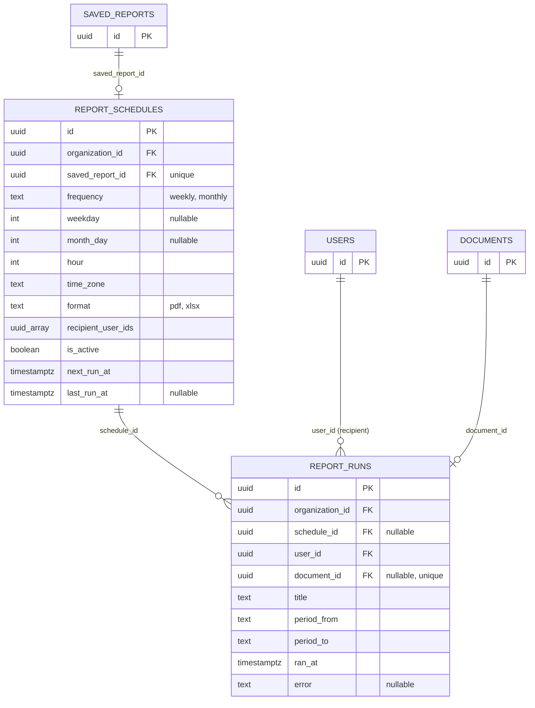

## Plugin-owned data

The plugin tables below are not part of the core Drizzle schema.\
They are created by each plugin's Liquibase changelog and introspected into that plugin's `api/db/schema.ts`.\
Standard product builds include the private plugin code; rebuilding from source requires the supplied plugin source trees or authorized access to their repositories.\
These plugins own 39 tables: 34 in plugin schemas and 5 expenses tables in `public`; the tables exist in a database after their changelogs are migrated.\
Installing the code does not by itself enable a module or satisfy its license requirement.\
Tables reference core records where appropriate, but polymorphic references such as `(source_table, source_id)` intentionally have no foreign key.

| Plugin / schema | Tables | Purpose |
|---|---|---|
| `billing` | `settings`, `customers`, `project_customers`, `person_rates`, `invoices`, `invoice_lines`, `invoice_items`, `written_off` | Organization billing settings and customers; project/customer rates; invoices and their lines; source-record links and write-offs. |
| `cases` | `cases`, `case_documents`, `case_interviews`, `assessment_templates`, `assessments`, `user_keys`, `case_keys` | Confidential case dossiers, document and interview records, assessment templates and drafts, and the per-user/per-case key envelopes used by browser-side encryption. |
| `expenses` (`public`) | `expenses`, `expense_reports`, `expense_report_items`, `expense_payruns`, `expense_vat_lines` | Expenses and approval reports; report membership; payout runs; per-expense VAT amounts and booking lines. |
| `hr` | `work_permits`, `year_statements`, `exit_statements`, `reviews` | Work permits; issued year-end and exit balance statements; employee review records. |
| `hrplus` | `settings`, `templates`, `checklists`, `certificates`, `items`, `loans` | Organization settings and onboarding/offboarding templates and checklists; employee certificates; tracked equipment and loans. |
| `notes` | `notes` | Personal and organization notes, scoped by organization and user. |
| `roster` | `shift_types`, `demand`, `profiles`, `assignments`, `published`, `wishes` | Shift definitions and staffing demand; roster profiles and assignments; published plans and employee shift wishes. |
| `whistle` | `reports`, `messages` | Confidential whistleblowing reports and their reporter/handler message thread. |

`cases.assessments` stores the section content, custom values, evidence and assessor guidance; for encrypted cases those sensitive fields are sealed in the `enc` envelope, and plaintext compute requests are not persisted.\
The `cases.case_documents` and `cases.case_interviews` rows can also carry encrypted content; file bytes remain in the core document store.\
`cases.user_keys` and `cases.case_keys` store wrapped key material, never a passphrase or an unwrapped private or case key.\
`billing.invoice_items` maps source records to invoice lines by `(source_table, source_id)`; `billing.written_off` records written-off expense sources. These polymorphic source ids intentionally have no FK.

The HR and HR Plus plugins use different schemas (`hr` and `hrplus`), and their rows remain separate from the core's `users`, `organizations`, `documents` and `personnel_documents` tables.

## Not diagrammed

- Liquibase's own bookkeeping tables `databasechangelog` /
  `databasechangeloglock`.

---

Refreshed against the generated core and plugin Drizzle schemas and the Liquibase changelogs on 2026-11-26.\
A styled, interactive version of this reference is also published as a Claude artifact.
